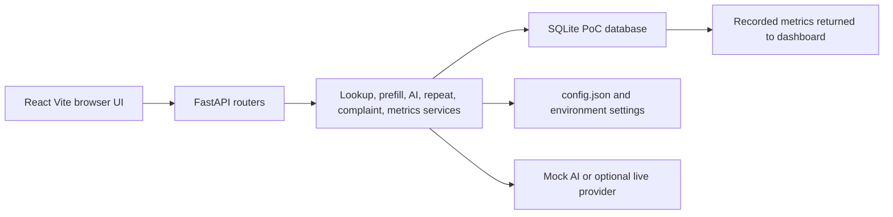

# Architecture

## Runtime structure

The browser client is a React and TypeScript Vite application in `frontend/`. `frontend/src/features/register/Register.tsx` owns the six-step registration workflow, while `frontend/src/App.tsx` provides navigation for registration, history, dashboard, taxonomy, evaluation, configuration, and PoC information.

The backend is a FastAPI application in `backend/app.py`. It initializes the SQLite schema and synthetic seed data, applies request IDs, request-size handling, CORS, and a consistent error envelope. Route modules expose lookup, configuration, complaint, session, analytics, review, and evaluation operations. Backend permissions are based on synthetic demo users sent through `X-Demo-User`; this is a demonstrator control, not production authentication.

## Request and persistence flow

Customer search and context are read from synthetic SQLite records. Prefill combines selected context, complaint-type defaults, and field provenance. Summary, classification, and email extraction are served by `backend/services/ai.py`; responses are Pydantic-validated and controlled failures leave manual registration available. Repeat detection is deterministic logic in `backend/services/repeat.py`, not an AI decision.

## Data model

SQLite stores customers, sites, contracts, orders, complaint types, root causes, users, complaints, sessions, field events, step events, AI events, repeat checks, repeat disputes, audit events, evaluations, and configuration versions. `backend/services/complaints.py` saves a complaint, repeat evidence, session outcome, and audit events in one transaction. The only persistence target is the local PoC database.

## Security boundary

`backend/services/complaints.py` has no external write client. The application is structurally PoC-only: synthetic seed data, local SQLite persistence, placeholder environment values, and no production-system endpoint.
